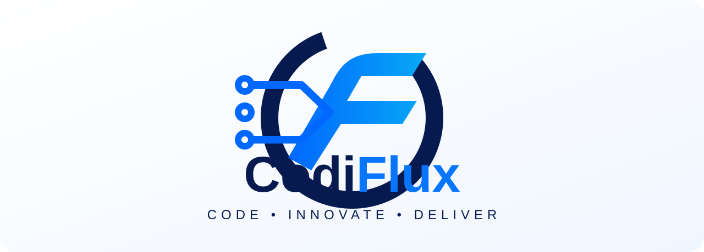

 

### Independent Software Development & Digital Products

We build software, mobile apps, web platforms and practical digital tools.

[Website](https://codiflux.com) · [Email](mailto:support@codiflux.com) · [GitHub](https://github.com/Officialcodiflux)

---

## About CodiFlux

CodiFlux is an independent software development brand focused on turning practical ideas into digital products. Our work spans business management software, mobile applications, web platforms and developer tools.

## Portfolio

### 🧩 Business & Management Software

| Product | Description |
|---|---|
| **GSMManagerPro** | Mobile shop management platform covering sales, inventory, IMEI, repairs and business workflows. |
| **Mobile-CBM** | Mobile-oriented CBM business software project. |
| **WhatsKart** | WhatsApp commerce platform concept. |
| **ConnectHub** | Digital platform project. |

### 📱 Mobile Applications

| App / Project | Description |
|---|---|
| **Hidayah** | Faith-focused mobile app project. |
| **Noor Hadith** | Hadith-focused mobile application. |
| **QuizFlux** | Quiz and learning app project. |
| **Aaj Ka Sitara** | Daily horoscope-themed app project. |
| **CodiFlux Call Recorder** | Call recording app project. |
| **CodiFlux Recipes** | Recipe-focused app project. |

### 🌐 Web Platforms & Experiments

| Project | Description |
|---|---|
| **PakDirectory** | Pakistan-focused directory platform. |
| **Food Discovery** | Food discovery platform experiment. |
| **Paper Composer** | Application project. |

### 🛠️ Developer Tools

| Project | Description |
|---|---|
| **UDM — Universal Download Manager** | Download manager project under development. |
| **GMap & Social Extractors** | Data extraction tool experiments. |

Some projects are private, experimental, planned or under development. This portfolio does not imply that every project is publicly available or released.

---

## Technologies

## Open Source

We plan to release selected projects, tools and resources for the developer community. Follow the repositories for updates, releases and source code.

## Connect

🌐 **[codiflux.com](https://codiflux.com)**  
📧 **[support@codiflux.com](mailto:support@codiflux.com)**

CODE · INNOVATE · DELIVER

